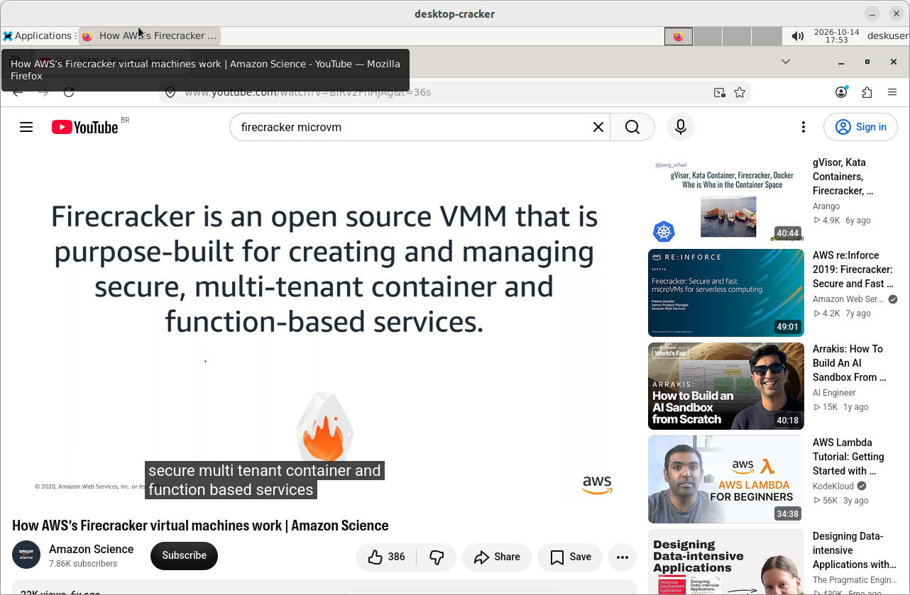
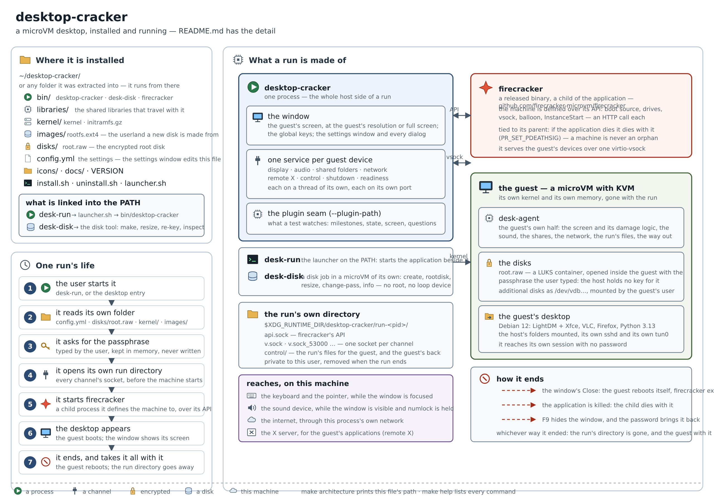

# desktop-cracker



*The guest's desktop — a Debian microVM booted by Firecracker — in this project's own window, its
sound on the host's output, its files in an encrypted disk of its own.  A screenshot of a real run
(`preview/preview.png`).*

> **Read this before you trust anything here.**
>
> This project was **vibe-coded**: an AI wrote the code and an AI validated it, both driven by a
> person who was pointing them at a goal rather than reviewing every line.  The harness that ran
> them was itself vibe-coded, and the model that generated and validated the code was
> **[Qwen3.8-Flash-Next-GSQ-RCO-GGUF](https://huggingface.co/ISTA-DASLab/Qwen3.8-Flash-Next-GSQ-RCO-GGUF/tree/main/IQ3_XXS)**.
>
> **Nothing here comes with a guarantee.**  Treat it as a starting point, not as something that has
> been proven: use other agents and other models to validate it yourself, and run it inside a
> virtual machine with **nested KVM** (Firecracker needs it) before you point it at anything you
> care about.

A **microVM desktop**: [Firecracker](https://github.com/firecracker-microvm/firecracker) with KVM
boots a virtual machine in a couple of seconds and its desktop is shown here, on this machine's
screen — an OpenGL window for the guest's screen, the keyboard and the mouse going to the guest, the
host's folders shared into it, an encrypted disk, and a network of its own that this process answers.

The hypervisor is **Firecracker** ([github.com/firecracker-microvm/firecracker](https://github.com/firecracker-microvm/firecracker),
Apache-2.0), a released binary this project does not build and does not modify: `make download`
fetches one, and the package ships it as it came.  Every kernel this project boots is Firecracker's
guest — its `guest_configs` are what the guest's kernel is built on, and its API is how the machine
is defined.

The picture of the whole thing — the package, the two programs of a run, the guest they carry and
the lifecycle of one run — is below.  The drawing itself is
[`architecture.svg`](architecture.svg) (a plain SVG, which is what `make architecture` prints the
path of); the image is the same picture, rendered:



Main language: **Rust**.  C is used where the kernel or the guest's tools leave no Rust option: the
guest's framebuffer module and the guest's own tooling.

**Licence: [MIT](LICENSE).**  What the project carries that is somebody else's — Firecracker and the
guest's Debian userland — is named, with its own licence, in the same file.

**Why a microVM.**  Firecracker starts a machine in seconds and every machine is a process with its
own kernel: fast enough to be somebody's desktop, isolated enough to be a sandbox.  A boot that
takes longer than that is a bug to investigate, not a fact to live with.

## What it does

* **the guest's desktop in a window**: Debian 12 with LightDM and Xfce, drawn by this project's own
  OpenGL window at the guest's resolution (1280x800, centered) or borderless full screen when the
  display is big.  The window is never resized down and never painted black.
* **the host's keyboard, taken apart for the guest**: typing goes to the guest while the window has
  the focus, and the two chords are read from the host's keyboard rather than from the window, so
  they work while the guest has it — `numlock + F9` hides the window (and asks for the unlock
  password before it comes back), `numlock + F10` opens the settings window.
* **the root disk**: one encrypted disk the guest boots from, made from the guest's own userland
  (`desk-disk rootdisk`, run in a microVM of its own).  It is a raw file holding a LUKS container
  with a partition table inside it, and it is opened **inside the guest** with the passphrase the
  user types: the host never holds a key, and nothing about the disk is written where a person
  could read it back.
* **additional disks**: as many as the settings list, each attached to the guest as its own device
  and mounted from inside it with `desk-disk-mount` — so a data disk, a backup disk or a disk
  somebody handed over never has to be opened by the host at all.
* **shared folders**: the host's folders, shared into the guest and mounted where the plan says,
  each with its own mode — the read-only ones enforced **on the host side**, so the guest cannot
  write to them even as root.
* **one port to the guest's own sshd**: `--ssh-port` (or the settings' `ssh_port`) carries a port on
  this machine's loopback to the guest's sshd, so the guest can be reached from a terminal without
  the sandbox ever being on the network.
* **the host's own services, from inside the guest**: the guest reaches the host by name
  (`parenthost`) and through the X server shared into it, so an application in the sandbox can open
  its window on this desktop and talk to a service running here; `--host-network` decides how much
  of the network the guest can reach.
* **sound** through the host's own audio, played only while the window is visible and the numlock
  key is held.
* **`desk-disk`**, the disk tool: make, resize, re-key and inspect a disk, each job in a microVM of
  its own — no root, no loop device, no package on the host.
* **`--plugin-path`**: a plugin sees the run's milestones, its state, its screen and the questions it
  would ask, which is how the system test drives a real run without the application growing
  test-only code.

## What is inside the guest

The userland the root disk is made from is built by `make rootfs` and is a Debian 12 desktop, ready
to use: **Xfce** (with Thunar, Mousepad, a terminal and Conky on the panel) behind **LightDM**, which
logs `deskuser` in with no password; **Firefox ESR** and **VLC** for the web and for video, both on
the host's sound; **ffmpeg** and **qBittorrent**; **audio and display control** (PulseAudio with
`pavucontrol`, the display settings); **GNOME Disks** and `udisks2` for the guest's own disks; the
**Python 3.13** this project builds from source, with `pip3`, `venv` and Tk; and the project's own
pieces — the guest agent, `guest-tools`, `desk-disk-mount` and the display library an application
links to.  `deskuser` is the guest's own user; its password is what `sudo` asks for inside the
guest, nothing else.

## What it needs

On the host: a C compiler, the archive tools (`gcc cpio gzip curl`), GTK3, GL, `libpulse-simple`,
glib/gio, and a readable `/dev/kvm` (being in the `kvm` group).  Building the guest's userland also
needs `docker`.  `make install-deps` **reports** what is missing and installs nothing behind your
back; `make dependencies` fetches the rest (the hypervisor, the base image, this project's own guest
kernel).

## Build and run

```bash
make dependencies     # the hypervisor, the base image and the guest's kernel into temp/download/
make                  # the application, the disk tool, the plugin, the guest's kernel + initramfs
make rootfs           # the guest's own userland (Debian 12, LightDM + Xfce, Firefox, VLC, Python)
make rootdisk         # an encrypted root disk from that userland, in a microVM of its own
make run              # the microVM: the guest's desktop in a window, network attached
make test             # unit tests (no KVM, no guest, no display server, no dialog)
make system-tests     # the one-pass system test: one boot, named steps, needs /dev/kvm
make check            # fmt + clippy + test
```

`make help` lists every command, and the top of the `Makefile` says what each one is for.
`make run` is deliberately **only a run**: it does not build anything, so it is fast — building is
`make build`'s job, and the guest's own two artefacts are `make rootfs` and `make rootdisk`.

Everything a build produces lands in **`target/` at the root of this tree** — one folder, whichever
crate inside the workspace it came from.

## Dist and install

```bash
make dist             # dist/desktop-cracker-<version>-x86_64.tar.gz (name carries the version)
make install          # extract that package at ~/ and run its install.sh
```

The package's folder is always `desktop-cracker/` (the version is inside it, in `VERSION`), so a new
release replaces the one it is extracted over instead of leaving several copies on the machine.  The
application runs **from the folder it was extracted into**: `install.sh` links `desk-run` and
`desk-disk` into the PATH, adds the desktop entry and the icon, and asks `apt-get` for the runtime
libraries that cannot be shipped — never a compiler and never a `-dev` package.  `make uninstall`
removes the package and the names it linked; it never touches the user's data
(`~/.desktop-cracker`).

## Layout

```
Makefile                    build, dependencies, rootfs, rootdisk, run, test, system-tests, dist
architecture.svg            the picture of the whole thing
desktop-cracker/            the Rust workspace: the application and every library it is made of
desktop-cracker/app/desktop/    the application (target/release/desktop-cracker)
desktop-cracker/app/disk/       the disk tool (target/release/desk-disk)
desktop-cracker/internal_libs/  the run, the channels, and the application's own libraries
desktop-cracker/plugin/         the test plugin (a cdylib the application loads by --plugin-path)
desktop-cracker/guest-agent-rs/ the guest's agent, in Rust, and the initramfs that starts it
desktop-cracker/guest-kernel/   the guest's framebuffer module, and the kernel configuration
                                it is built into
target/                     the build output, at the root of this tree
tools/                      the guest's userland, its display library, the probes
system-tests/               the one-pass system test: one file, one boot, named steps
scripts/                    the pieces the Makefile drives: the kernel, the userland, the package
temp/                       scratch, never committed: the media a run boots, the disks, the sockets
```

## Testing it

Unit tests mock the system: no KVM, no guest, no display server, no dialog, and no sleeping.  The
**system test** is one file, one boot and named steps, and it drives a real run from outside through
the plugin:

```bash
make system-tests SYSTEM_TEST_ARGS=--list
make system-tests SYSTEM_TEST_ARGS="--only boot"
```

It shows no window and no dialog.  The root disk's passphrase is typed by the person running it and
handed to the application as the answer to its own question — it is never written anywhere.
